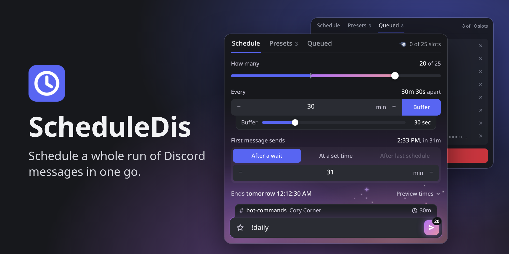
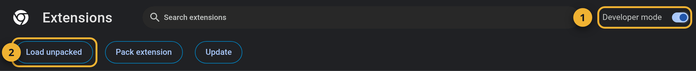
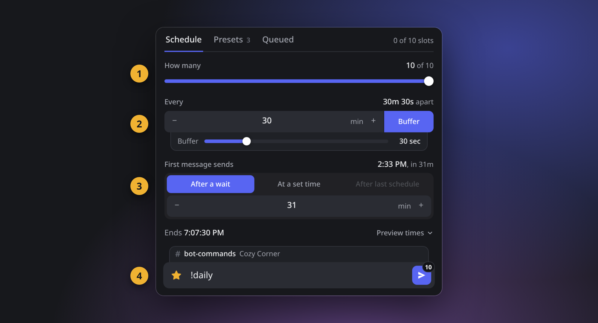
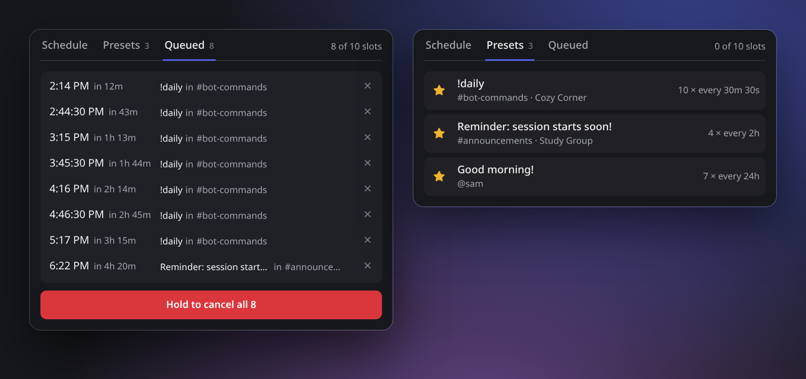

# ScheduleDis

Discord lets you schedule messages one at a time. ScheduleDis lets you set up a whole run at once: pick a message, how many times to send it, and how far apart. It's handy for reminders, repeating posts and commands for bots with a cooldown.

**[⬇ Download for Chrome, Edge and Brave](../../releases/latest/download/ScheduleDis.zip)** · **[⬇ Download for Firefox](../../releases/latest/download/ScheduleDis-firefox.xpi)**

Works in Chrome, Edge, Brave, similar browsers and Firefox 140 or newer, using Discord in the browser (not the desktop app). Your account needs Discord's scheduled messages feature.

## Install

### Firefox

1. Download the Firefox file above.
2. Type `about:addons` in your address bar and press Enter.
3. Click the gear icon, choose **Install Add-on From File**, pick the file you downloaded, and click **Add**.

To keep it handy, click the puzzle piece icon in your toolbar, click the gear next to ScheduleDis, and choose **Pin to Toolbar**.

### Chrome, Edge and Brave

1. Download the zip above and unzip it. Keep the `ScheduleDis` folder somewhere you won't delete it, because your browser keeps using it.
2. Type `chrome://extensions` in your address bar and press Enter.
3. Turn on **Developer mode** (top right), then click **Load unpacked** and choose the `ScheduleDis` folder.

To keep it handy, click the puzzle piece icon in your toolbar and pin ScheduleDis.

## How to use it

Open [Discord](https://discord.com/app) in your browser, go to the channel or DM you want, then click the ScheduleDis icon.

1. **How many:** drag the slider to choose how many messages to schedule.
2. **Every:** set the time between messages. Turn on **Buffer** to add a few extra seconds to each gap, which helps if a bot's cooldown is strict.
3. **First message sends:** choose a wait or a set time. Discord needs at least about 11 minutes' notice and allows up to 8 days ahead. Click **Preview times** to check every send time.
4. **Send:** type your message and press the send button.

Keep the Discord tab open until scheduling finishes. You can close the popup. Discord allows about 10 new scheduled messages at once, then roughly one every 3 minutes, so bigger runs take a while. Once they're scheduled, Discord sends them for you.

### Queued and Presets

- **Queued** shows everything you have scheduled, including messages you scheduled in Discord itself. Click ✕ to cancel one, or hold the red button to cancel them all.
- **Presets** keeps setups you use often. Press the ☆ next to your message to save one, then click it later to fill everything back in.

## Good to know

- **Slots:** Discord limits how many messages you can have scheduled at once. It's 10 without Nitro and more with it. The number you have is shown at the top right.
- **Text only:** ScheduleDis can't schedule images or files.
- **Updating in Firefox:** Firefox installs new versions by itself.
- **Updating in Chrome, Edge and Brave:** when a new version is out, an **Update** button appears at the top right of the popup. Click it and ScheduleDis installs the update and restarts itself. The first time, it asks you to choose your `ScheduleDis` folder and allow changes to it. Your browser may ask you to allow it again after a restart.
- **Updating by hand:** some browsers, including Brave by default, don't let extensions change their own files. The update page then gives you the download link: replace the contents of your `ScheduleDis` folder, then click the reload icon on ScheduleDis in `chrome://extensions`.

## If something's not working

| What you see | What to do |
| --- | --- |
| "Discord isn't open" | Open Discord in a browser tab. The desktop app doesn't count. |
| "Scheduled messages aren't on for this account" | Discord is rolling this feature out gradually, so your account doesn't have it yet. |
| "Discord changed something this extension relies on" | A Discord update broke something. Check here for a newer version. |

## Privacy and risk

ScheduleDis runs only on Discord's site, in your own browser. It never sees your password or login token, and it doesn't send your data anywhere except Discord. Your settings and presets stay in your browser. It also asks GitHub whether a new version is out, and downloads it from there when you click **Update**. In Firefox, the browser does this by itself.

ScheduleDis is an unofficial tool, and it isn't made by or affiliated with Discord. Discord's rules restrict automating user accounts, so **use it at your own risk**.
